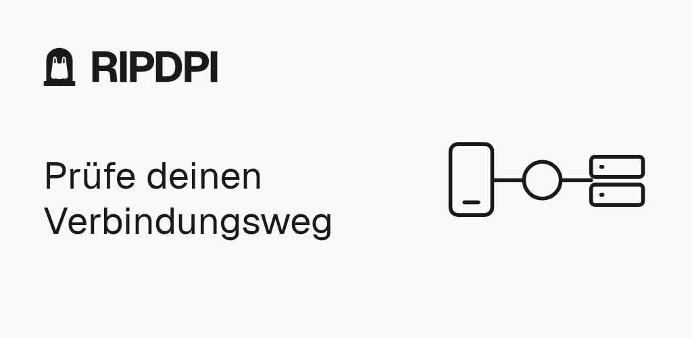
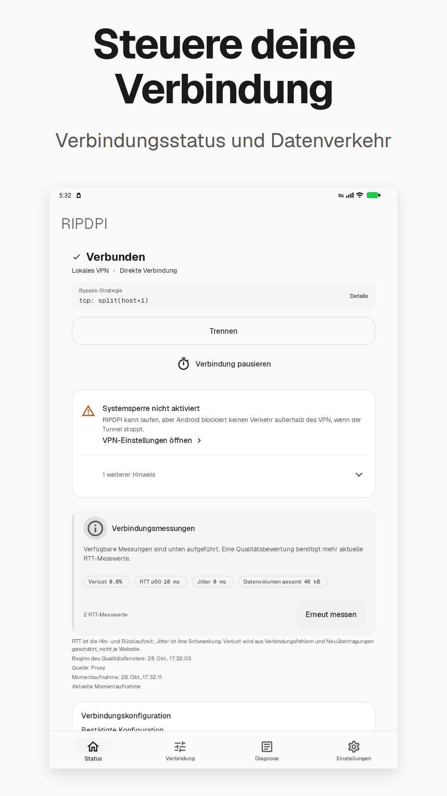
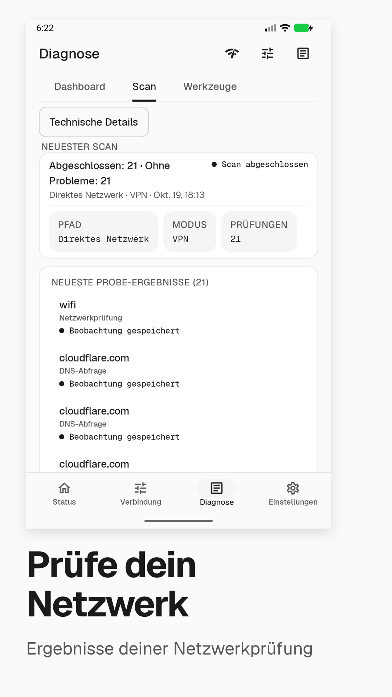
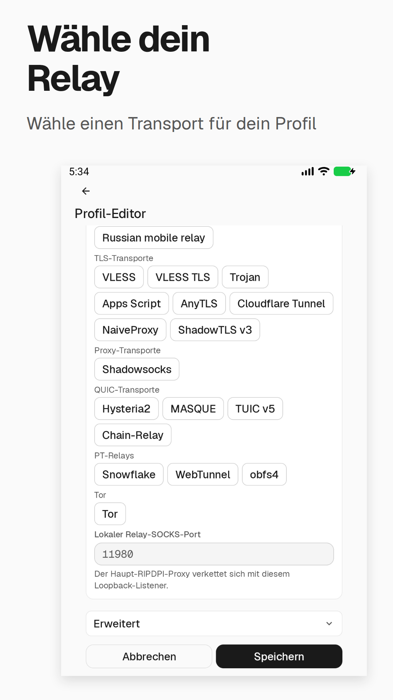
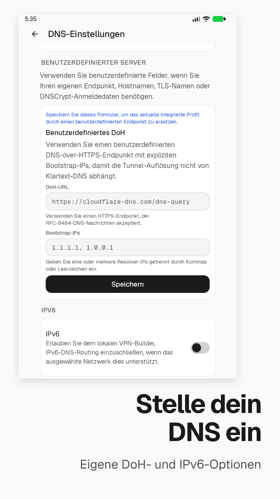
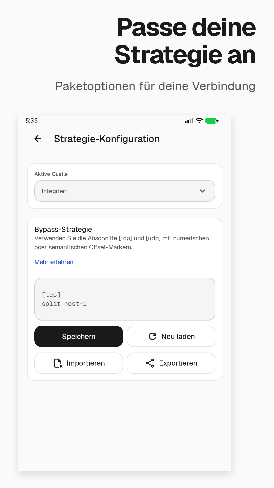
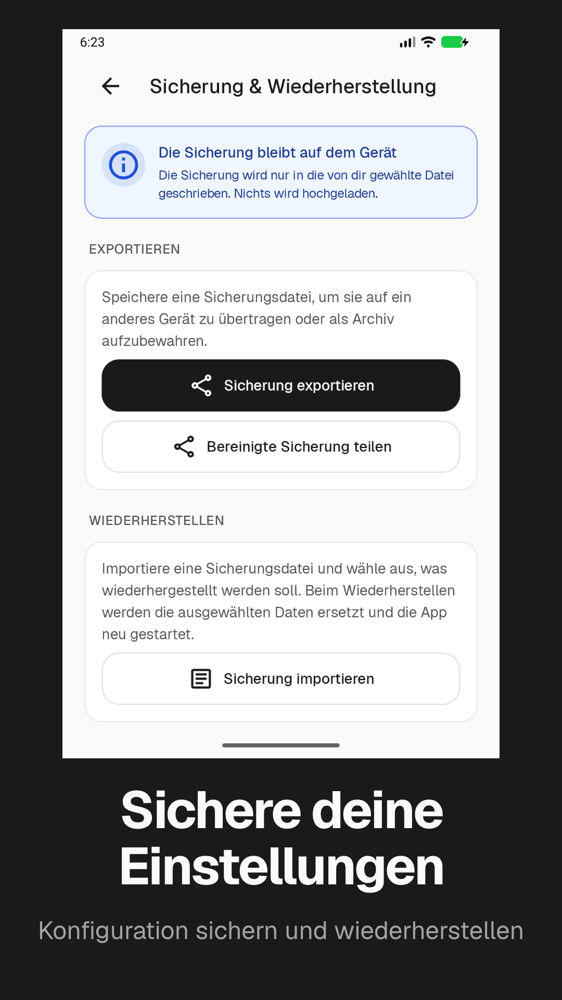

<p align="center">
  <a href="docs/screenshots/de/feature-graphic.png"></a>
</p>

<p align="center">
  <a href="https://github.com/po4yka/RIPDPI/actions/workflows/ci.yml"></a>
  <a href="https://github.com/po4yka/RIPDPI/releases/latest"></a>
  <a href="LICENSE"></a>
  &nbsp;
  
  
  
</p>

<p align="center"><a href="README.md">English</a> | <a href="README-ru.md">Русский</a> | <a href="README-es.md">Español</a> | <b>Deutsch</b> | <a href="README-fr.md">Français</a> | <a href="docs/fa/README.md">فارسی</a> | <a href="README-zh-CN.md">简体中文</a> | <a href="README-hi.md">हिन्दी</a> | <a href="README-pt-BR.md">Português (Brasil)</a></p>

> [!WARNING]
> **Das Projekt befindet sich in einer aktiven Entwicklungsphase.** Neue Funktionen werden hinzugefügt und häufig werden umfangreiche Refactorings durchgeführt, um die Qualität der Codebasis zu verbessern. Dabei werden Coding-Agenten intensiv eingesetzt, daher sind auf `main` aktuell **Breaking Changes, Schema-Migrationen und teilweise fehlerhafte Funktionalität möglich**. Wenn Sie auf eine Regression stoßen, [öffnen Sie bitte ein Issue](https://github.com/po4yka/RIPDPI/issues) — Ihr Feedback hilft, das Projekt zu stabilisieren.

RIPDPI ist ein Android-Toolkit zur Diagnose und Optimierung des Netzwerkpfads. Es misst, warum ein Ziel ausfällt oder sich verschlechtert, wendet konfigurierbare Paketstrategien auf dem Gerät an und kann über Relay-Server verbinden, die Sie kontrollieren. Jede Fähigkeit funktioniert einzeln oder in Kombination.

## Den Pfad sehen, nicht nur einen Schalter

<p align="center">
  <a href="docs/screenshots/de/01-hero.png"></a>
  <a href="docs/screenshots/de/02-diagnostics.png"></a>
</p>

<p align="center">
  <a href="docs/screenshots/de/03-relays.png"></a>
  <a href="docs/screenshots/de/04-dns.png"></a>
</p>

<p align="center">
  <a href="docs/screenshots/de/05-strategies.png"></a>
  <a href="docs/screenshots/de/06-local-tools.png"></a>
</p>

Google Play-Bilder mit echten App-Ansichten. Öffne ein Bild in voller Größe. [Aufnahme und Export](play-store-screenshots/README.md).

Statt einer einzigen globalen Richtlinie klassifiziert RIPDPI jedes Ziel und jedes Netzwerk getrennt, merkt sich validierte Ergebnisse und macht seine Fehlerurteile sichtbar. Beginnen Sie lokal; setzen Sie ein Relay erst ein, wenn sich der direkte Pfad nicht wiederherstellen lässt.

## Schnellstart

Richten Sie die [Build-Voraussetzungen](#build-requirements) ein, einschließlich der Toolchain für das echte libXray-AAR, bevor Sie diese Befehle ausführen.

Den Android-Debug-APK aus dem Quellcode bauen:

```bash
git clone https://github.com/po4yka/RIPDPI.git
cd RIPDPI
bash scripts/native/build-libxray.sh
bash scripts/native/verify-libxray-artifacts.sh
./gradlew assembleDebug
```

Lesen Sie die [Build-Voraussetzungen und Ausgabepfade](#build-requirements), bevor Sie ein Gerät oder einen Release-Build vorbereiten.

## Drei Fähigkeiten, ein Entscheidungskreislauf

### Paketstrategien auf dem Gerät

Wendet konfigurierbare Transformationen auf Paketebene direkt auf dem Gerät an, ohne den Datenverkehr über einen Relay-Server zu leiten. Für den Kernpfad sind keine Root-Rechte erforderlich.

Unterstützte Techniken: TCP-Segmentaufteilung und -Unordnung, Einschleusung gefälschter Pakete, OOB (Urgent Pointer), TLS-Record-Fragmentierung, gefälschter TLS-First-Flight, QUIC-Handshake-Variation, Variation des UDP-Längenfelds, Einfügen von IPv6-Erweiterungsheadern, Lua-definierter Rohpaketversand sowie adaptive semantische Marker, die ihre Position anhand des Live-`TCP_INFO` auflösen. Strategieketten werden aus Rust-Crates in diesem Repository erstellt, ohne externe Strategie-Binärdatei.

Wenn kein Relay konfiguriert ist, verlässt der Datenverkehr das Gerät direkt – die einzigen Änderungen am Pfad sind die Mutationen auf dem Gerät.

### Diagnose

Prüft jedes Verbindungsziel einzeln und erzeugt eines von drei typisierten Ergebnissen:

- `TRANSPARENT_WORKS` — ein geprüfter transparenter Pfad funktioniert, mit oder ohne Strategien auf dem Gerät
- `OWNED_STACK_ONLY` – funktioniert nur über den app-eigenen TLS-Stack
- `NO_DIRECT_SOLUTION` — im Budget dieses Laufs war keine geprüfte direkte Lösung erfolgreich; ein Relay oder einen weiteren Test erwägen

Ein vermuteter Block wird separat in `transportClass` erfasst, etwa als `IP_BLOCK_SUSPECT`, `SNI_TLS_SUSPECT` oder `QUIC_BLOCK_SUSPECT`. Diese Klassen beschreiben Hinweise auf eine mögliche Ursache; sie sind keine weiteren Ergebnisvarianten und kein Nachweis einer Blockierung.

Urteile werden pro Netzwerk-Fingerabdruck gespeichert und automatisch wiedergegeben, sobald dasselbe Netzwerk erneut erkannt wird. Der Diagnosebildschirm ergänzt TCP- und QUIC-Strategie-Probing aus den Suites `ripdpi-diagnostics-candidates` (quick/full-matrix), die Erkennung von DNS-Manipulationen, Empfehlungen für DoH-/DoT-/DNSCrypt-/DoQ-Resolver sowie exportierbare Diagnosearchive.

### Optionales VPN-Relay

Leitet den Datenverkehr des lokalen Proxys oder VPNs über verschlüsselte Relay-Protokolle zu einem von Ihnen konfigurierten Server:

| Kind / protocol | Integration tier | Scope | Traffic |
| --- | --- | --- | --- |
| `vless_reality` / VLESS Reality TCP | Native relay-core backend (`ripdpi-vless`) | Client relay | TCP + UDP (XUDP) |
| `vless_reality` / xHTTP transport | Native relay-core backend (`ripdpi-xhttp`) | Client relay | TCP |
| `cloudflare_tunnel` | Native xHTTP relay path plus optional Cloudflare publish runtime | Client relay / local-origin publish | TCP |
| `hysteria2` | Native relay-core backend (`ripdpi-hysteria2`) | Client relay | TCP + UDP |
| `tuic_v5` | Native relay-core backend (`ripdpi-tuic`) | Client relay | TCP + UDP |
| `masque` | Native relay-core backend (`ripdpi-masque`): HTTP/2 classic CONNECT for TCP, HTTP/3 CONNECT-UDP for UDP | Client relay | TCP + UDP |
| `shadowtls_v3` | Native relay-core backend (`ripdpi-shadowtls`) with a profile-backed inner relay | Client relay | TCP |
| `trojan` | Native relay-core backend (`ripdpi-trojan`) | Client relay | TCP + UDP |
| `anytls` | Native relay-core backend (`ripdpi-anytls`) | Client relay | TCP + UDP |
| `shadowsocks` | Native relay-core backend (`ripdpi-shadowsocks`) | Client relay | TCP + UDP |
| `tor` | Native Arti-backed relay-core backend (`ripdpi-tor`) with bridge/PT bootstrap | Opt-in client anonymity relay | TCP |
| `naiveproxy` | External helper process (`ripdpi-naiveproxy`) supervised by Android service code | Client relay | TCP |
| `google_apps_script` | In-repository Rust Apps Script relay runtime (`ripdpi-apps-script-core`) selected by `libripdpi-relay.so` | Client relay path | TCP |
| `snowflake` | External Go pluggable-transport binary (`ripdpi-snowflake`) | Client PT relay | TCP |
| `webtunnel` | In-repository Rust pluggable-transport helper binary (`ripdpi-webtunnel`) | Client PT relay | TCP |
| `obfs4` | External pluggable-transport binary (`ripdpi-obfs4`) | Client PT relay | TCP |
| `chain_relay` | Native relay-core composition over referenced relay profiles | Ordered 2-4 hop client relay | TCP |
| `mieru` | Native relay-core backend (`ripdpi-mieru`); UDP relay gated off pending the custom UDP/TCP wire engine | Client relay | TCP |
| `ssh` | Native relay-core backend (`ripdpi-ssh`) | Client relay | TCP |
| `vless` / xHTTP transport | Native relay-core backend (`ripdpi-xhttp`), xHTTP/TLS | Client relay | TCP |

Einfaches `vless` hat ein natives xHTTP/TLS-Backend; andere einfache VLESS-Transporte werden von diesem Backend nicht unterstützt. VLESS Reality nutzt XUDP nur bei aktiviertem UDP, dem Transport `reality_tcp` und dem Flow `xtls-rprx-vision` oder `xtls-rprx-vision-udp443`. xHTTP unterstützt nur TCP.

Snowflake bleibt bewusst eine externe Go-Binärdatei; siehe die [Entscheidung gegen ein natives Rust-Snowflake](docs/architecture/snowflake-native-rust-decision.md). VLESS Reality verwendet kein echtes ECH; zur reinen GREASE-Richtlinie siehe [ADR 0001](docs/adr/0001-reality-ech.md).

WARP und AmneziaWG sind getrennte VPN-/Tunnel-Profilbereiche und keine `relay_kind`-Werte der relay-core-Registry.

Sowohl der lokale Proxy-Modus als auch der Android-VPN-Umleitungsmodus funktionieren mit oder ohne konfiguriertes Relay.

## Warum dieser Ansatz

Moderne Android-Netzwerke wenden regelmäßig L7-Fingerprinting (TLS JA3/JA4, QUIC), aggressives QoS in Mobilfunk- und öffentlichen WLAN-Netzen, MTU- und ECN-Desync sowie durch Middleboxen verursachte TLS-Handshake-Abbrüche an – was dazu führt, dass einige Ziele ausfallen, während andere im selben Netzwerk einwandfrei funktionieren. Eine einzelne globale Einstellung kann nicht alle Fälle abdecken.

Das Designprinzip von RIPDPI: Jedes Ziel und jedes Netzwerk separat klassifizieren, die leichteste funktionierende Lösung anwenden und sie sich merken.

1. **Antwort pro Ziel, pro Netzwerk** – keine einheitliche globale Richtlinie. Die Diagnose klassifiziert jede Autorität und speichert das Urteil mit einem Netzwerk-Fingerabdruck-Hash als Schlüssel.
2. **Den lokalen Pfad mutieren, wenn das Netzwerk das Problem ist.** Semantische Marker, adaptive Split-Platzierung, Fake-Payload-Ketten, OOB/Unordnung, randomisierte TLS-Records, QUIC-Fingerabdruck-Variation – zusammengestellt aus Rust-Crates im Repository.
3. **Auf ein getunneltes Relay zurückgreifen, wenn der direkte Pfad beeinträchtigt ist.** Die Relay-Matrix oben unterscheidet native relay-core backends, helper subprocesses, external pluggable transports und separate VPN/tunnel profile surfaces.
4. **Ehrliche Berichterstattung.** Urteile sind typisiert und werden angezeigt; Ergebnisse des Fehlerklassifizierers werden offengelegt, statt unterdrückt; exportierte Diagnose-Bundles entfernen Geheimnisse.

## Funktionen

- **Proxy-Modus**: lokaler SOCKS5-Proxy auf dem konfigurierten Localhost-Port.
- **VPN-Modus**: leitet den Datenverkehr des Android-Geräts über `VpnService` durch eine lokale TUN-zu-SOCKS-Bridge.
- **Profilimport**: Ein gemeinsamer Klassifikator bedient den QR-Scanner (Kamera oder gespeichertes Bild), die Zwischenablage und das Android-Teilen-Menü (Full-Variante). Er akzeptiert Proxy-URIs (`vless://`, `ss://`, `trojan://`, `hysteria2://`, `hy2://`, `anytls://`, `tuic://`, `mieru://`, `ssh://`), Abonnement-Links (`https://` sowie die Abonnement-Links `ripdpi://`, `sing-box://`, NekoBox `sn://`, Clash, v2rayNG und Hiddify), WireGuard-/AmneziaWG-`.conf`-Text, `amneziawg://`-Links und AmneziaVPN-`vpn://`-Schlüssel, auch als mehrteilige QR-Serie. **Profil hinzufügen** in den VPN-Einstellungen öffnet außerdem einen Bildschirm für Abonnement-Links und eine `.conf`-Dateiauswahl. Profile lassen sich auch als QR-Code teilen.
- **Links für Support-Einstellungen**: `ripdpi://support-config` und verifizierte HTTPS-Support-Links können nach Bestätigung durch den Nutzer einen vom Support bereitgestellten Patch für jede gespeicherte App-Einstellung anzeigen und anwenden.
- **Abonnements**: base64-, Clash / Clash.Meta-YAML-, sing-box-JSON- und WireGuard-INI-Abonnementformate mit automatischer Hintergrundaktualisierung, Erkennung doppelter Profile, Selector-/urltest-Gruppen und Multi-Mirror-Auslieferung.
- **Server-Migrationsbelege**: Ein Ersatz-Abonnement kann eine exakte Zustellidentität beibehalten. Im Abonnementstatus lässt sich ein angegebener Ersatzpfad gezielt testen und ein lokaler JSON-Beleg teilen. Reality/Vision, XHTTP und Hysteria2 nutzen isolierte Kandidatenprüfungen; AmneziaWG erfordert, zuerst das importierte Ersatzprofil zu verbinden. Belege „nur empfangen“ und „getestet“ sind getrennt; keiner wird automatisch hochgeladen.
- **Verschlüsseltes DNS**: Unterstützung für DoH-, DoT-, DNSCrypt- und DoQ-Resolver in VPN-bezogenen Pfaden.
- **Strategie-Steuerung**: TCP-Familien für Split/Unordnung/Fake, TLS-Record-Fragmentierung und Fake-Profile, QUIC-Handshake-Variation, Variation des UDP-Längenfelds, IPv6-Erweiterungsheader, Lua-`rawsend`, schrittweise Aktivierungsfilter, IPv4-ID-Steuerung und OOB-Einschleusung.
- **Netzwerkbezogenes Richtlinien-Gedächtnis**: validierte autoritätsspezifische Urteile, mit einem Netzwerk-Fingerabdruck verschlüsselt; werden bei erneuter Verbindung automatisch wiedergegeben.
- **Adaptives Probing**: automatisches Strategie-Probing für erstmals gesehene Netzwerke; Hintergrund-`quick_v1`-Neuprüfung bei Netzwerkwechsel.
- **Handover-bewusster Neustart**: dynamische Neubewertung der Richtlinien bei Übergängen zwischen WLAN, Mobilfunk und Roaming.
- **RIPDPI Browser**: app-eigener Browser für HTTPS-Ziele, die den app-eigenen TLS-Stack erfordern; gemeinsamer `SecureHttpClient`-Pfad für von der App ausgehende Anfragen.
- **Laufzeit-Telemetrie und Protokolle**: Proxy-Lebenszyklus, Routenentscheidungen, DNS-Failover-Ereignisse, Diagnosefortschritt und native Laufzeitereignisse – verfügbar als In-App-Verlauf und Support-Export.
- **Optionaler Root-Helfer**: schaltet auf gerooteten Geräten Operationen mit rohen Sockets frei (FakeRst, MultiDisorder, IP-Fragmentierung, vollständiges SeqOverlap, Versand roher IPv4-/IPv6-Pakete) über einen privilegierten Helferprozess.

## Laufzeitmodi

### Proxy

SOCKS5-Proxy auf einem konfigurierten Localhost-Port. Für Anwendungen, die Proxy-Konfiguration unterstützen. Strategie-Mutationen und Relay-Verkettung werden auf den gesamten Datenverkehr angewendet, der über den Proxy eingeht.

### VPN

Verwendet den Android-`VpnService`, um den Gerätedatenverkehr durch die lokale Engine von RIPDPI umzuleiten. Wenn kein Relay konfiguriert ist, wendet der VPN-Modus Mutationen auf dem Gerät an, ohne die Ausgangs-IP zu ändern. Wenn ein Relay konfiguriert ist, wird der Datenverkehr verschlüsselt an den konfigurierten Endpunkt weitergeleitet.

## Datenschutz

RIPDPI erfasst Betriebsmetadaten für Diagnose und Fehlersuche: Netzwerk-Snapshots, Resolver-Status, Routing-Entscheidungen, Scan-Ergebnisse, Dienstzustand und native Laufzeitereignisse.

Im Normalbetrieb werden keine Pakete mitgeschnitten, keine Nutzdaten des Datenverkehrs gespeichert und keine TLS-Geheimnisse aufgezeichnet. Der erweiterte Paketmitschnitt ist ein ausdrücklich zu aktivierendes Diagnosewerkzeug: Er speichert rohe Paketbytes lokal mit begrenzter Aufbewahrung und nimmt sie nur dann in ein Archiv auf, wenn der Nutzer dieses Archiv bewusst teilt.

Die Privatsphäre des Relay-Datenverkehrs hängt vom Relay-Endpunkt und dem von Ihnen konfigurierten Profil ab.

Mehrstufige Relay-Ketten führen eine geordnete Liste von 2 bis 4 TCP-Hops (Eingang, optionale Zwischenstationen, Ausgang). Das gespeicherte Profilmodell, das native Wire-Schema (`chainHops`), die Telemetrie pro Hop und der Ketteneditor tragen alle die geordnete Hop-Liste; die frühere Zwei-Hop-Form `chainEntry`/`chainExit` bleibt als abwärtskompatible Spiegelung (hop[0]/hop[last]) erhalten, damit bestehende Zwei-Hop-Konfigurationen sauber migrieren. Die Grenze von 2 bis 4 wird als typisierter Validierungsfehler durchgesetzt, nicht durch stilles Abschneiden. UDP über eine Kette wird bewusst nicht unterstützt (`udpCapable=false`). Eine Kette verbessert die Anti-Korrelation nur, wenn die Hops in unterschiedlichen Vertrauensdomänen liegen; derselbe Betreiber oder dieselbe Jurisdiktion über mehrere Hops hinweg kann falsche Sicherheit vermitteln und wird in der Oberfläche als Warnung angezeigt.

## Build-Voraussetzungen

Voraussetzungen: JDK 17, Android SDK (Plattform `37.1`, CMake `3.31.6`), Android NDK `29.0.14206865`, Rust-Toolchain `1.98.1`, Android-Rust-Targets für die benötigten ABIs, [`just`](https://just.systems) (Task-Runner; die Rezepte der `justfile` spiegeln CI) und [`lefthook`](https://github.com/evilmartians/lefthook) (einmal `lefthook install` ausführen, um die Pre-Commit-Prüfungen einzurichten).

Ein neuer Checkout benötigt vor der APK-Paketierung auch das echte libXray-AAR mit den Projekt-Patches. amd64-Go, die festgelegten Versionen von `gomobile` und `gobind` sowie `ANDROID_NDK_HOME` gemäß [libXray-Anleitung](docs/native/libxray-packaging.md#build) vorbereiten. Der Erzeuger benötigt ein neues oder leeres Verzeichnis `native/xray/artifacts/` und Zugriff auf die festgelegten Quellen. Ein geprüftes, zu den aktuellen Versionen passendes Artefaktverzeichnis lässt sich mit `-Pripdpi.prebuiltXrayAarDir=/absolute/path/to/artifacts` an Gradle übergeben; die Paketierungsprüfung bleibt aktiv.

Installieren Sie die benötigten SDK-Pakete mit Android CLI 1.0+:

```bash
android sdk install platforms/android-37.1 ndk/29.0.14206865 cmake/3.31.6
```

```bash
git clone https://github.com/po4yka/RIPDPI.git
cd RIPDPI
bash scripts/native/build-libxray.sh
bash scripts/native/verify-libxray-artifacts.sh
./gradlew assembleDebug
```

Lokale Builds verwenden standardmäßig `host` (`ripdpi.localNativeAbisDefault`) — die ABI wird aus der Host-Architektur abgeleitet (z. B. `arm64-v8a` auf Apple Silicon). Für den Emulator: `./gradlew assembleDebug -Pripdpi.localNativeAbis=x86_64`.

APK-Ausgaben liegen in variantenspezifischen Verzeichnissen, zum Beispiel `app/build/outputs/apk/githubFull/debug/`; Release-Aufgaben und -Pfade stehen in [distribution.md](docs/distribution.md).

Lokale Debug-Builds verwenden Stub-Starter für Snowflake, obfs4, WebTunnel und den Cloudflare-Publish-Helfer. Diese Helfer können im Standard-Debug-APK keinen Verkehr übertragen. Für echte Helfer sind zusätzlich zu Rust/NDK Go und Git sowie Zugriff auf die festgelegten Repositories und Go-Module erforderlich. Die Go-Versionen stehen im [Quellmanifest](native/pluggable-transports/sources.json). Strikte Fehlerbehandlung stoppt den Build, wenn ein Helfer nicht gebaut werden kann:

```bash
./gradlew assembleDebug \
  -Pripdpi.pluggableTransportAssetsMode=source \
  -Pripdpi.pluggableTransportAssetsStrictFailures=true
```

## Tests

```bash
./gradlew testDebugUnitTest
bash scripts/ci/run-rust-native-checks.sh
bash scripts/ci/run-rust-network-e2e.sh
./test-lab/scripts/start-lab.sh --profile emulator
./test-lab/scripts/adb-install-debug.sh
./test-lab/scripts/adb-run-probe-emulator.sh --mode diagnostics
./test-lab/scripts/stop-lab.sh
python3 -m unittest scripts.tests.test_offline_analytics_pipeline
```

Details: [docs/testing.md](docs/testing.md)

## Dokumentation

**Neu bei RIPDPI?** Empfohlene Lesereihenfolge:
[Architekturübersicht](docs/architecture/ARCHITECTURE.md) →
[Laufzeitmodi](docs/architecture/RUNTIME_MODES.md) →
[nativer Rust-Workspace](docs/architecture/NATIVE_RUST.md) →
[Kotlin/Rust-JNI-Vertrag](docs/architecture/JNI_CONTRACT.md) →
[Konfigurationsverträge](docs/architecture/CONFIG_CONTRACTS.md) →
[Leitfaden zur Funktionserweiterung](docs/architecture/FEATURE_EXTENSION_GUIDE.md).

- [Native Integration und Module](docs/native/README.md)
- [Paketstrategie-Laufzeit](docs/packet-strategy-runtime.md)
- [Proxy-Engine und Strategie-Schnittstelle](docs/native/proxy-engine.md)
- [TUN-zu-SOCKS-Bridge](docs/native/tunnel.md)
- [Strategie-Pack- und TLS-Katalog-Operationen](docs/strategy-pack-operations.md)
- [Beispiele für Relay-Profile](docs/relay-profile-examples.md)
- [Serverkonfiguration importieren](docs/server-integration.md)
- [Lokales Netzwerk-Testlabor](test-lab/README.md)
- [Externe UI-Automatisierung](docs/automation/README.md)
- [Architektur-Notizen](docs/architecture/README.md)
- [Roadmap](ROADMAP.md)

## RIPDPI übersetzen

Übersetzungen werden von der Community über GitHub-Pull-Requests beigetragen. Hinweise zum Hinzufügen oder Verbessern einer Sprache stehen in [docs/localization.md](docs/localization.md), Status und Prüfdaten im [Herkunftsverzeichnis](docs/localization-provenance.md). Strukturprüfungen belegen keine sprachliche Genauigkeit; Arabisch, Hindi und brasilianisches Portugiesisch warten noch auf eine Prüfung durch Muttersprachler.
