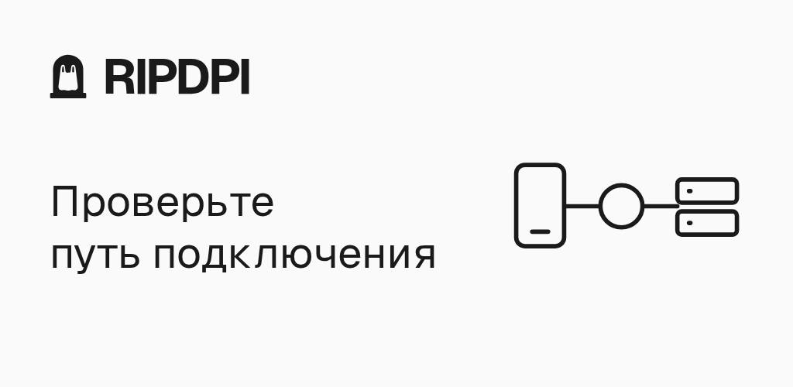
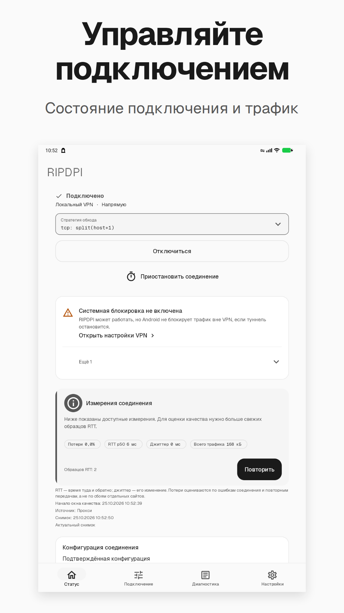
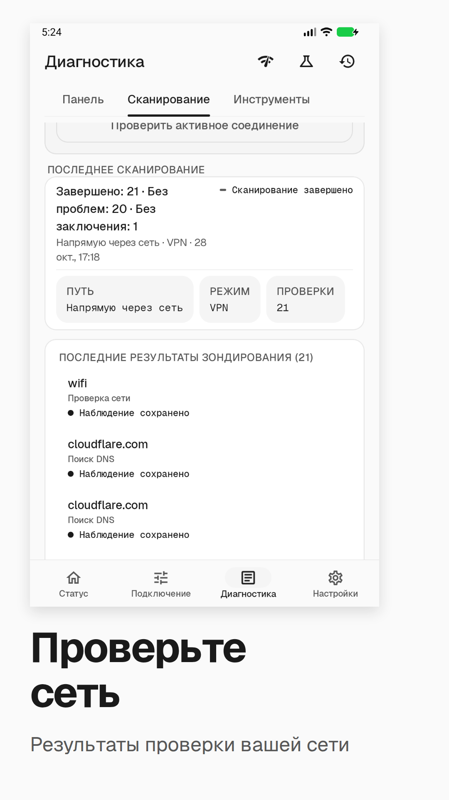
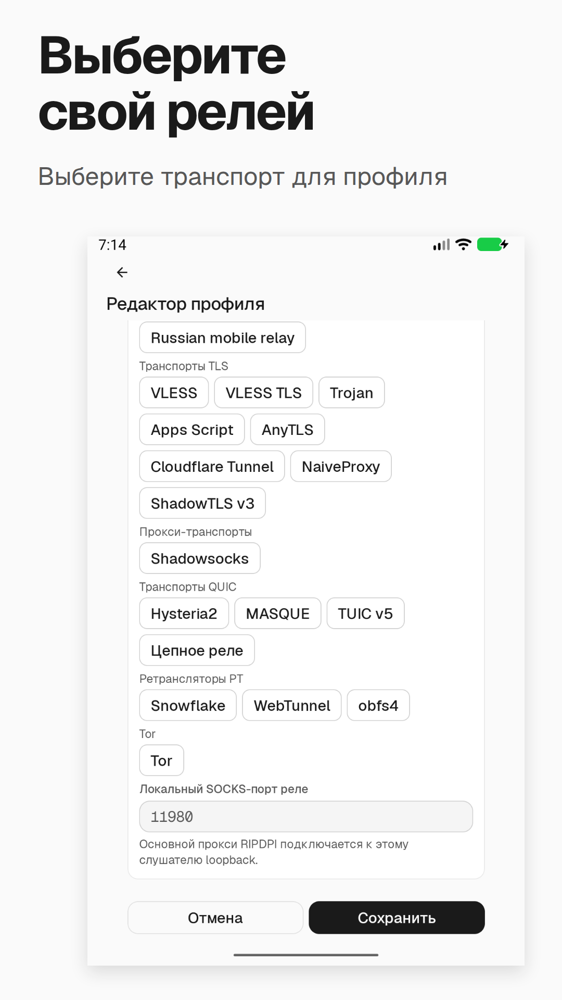
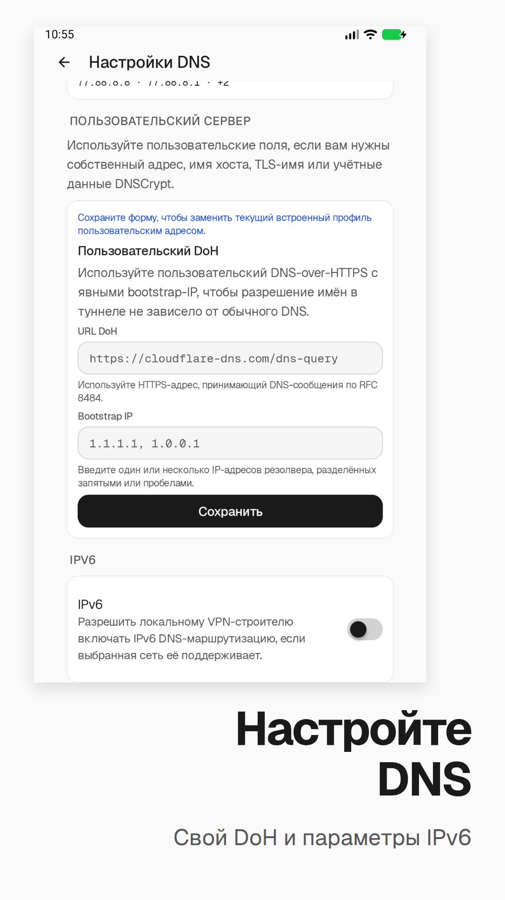
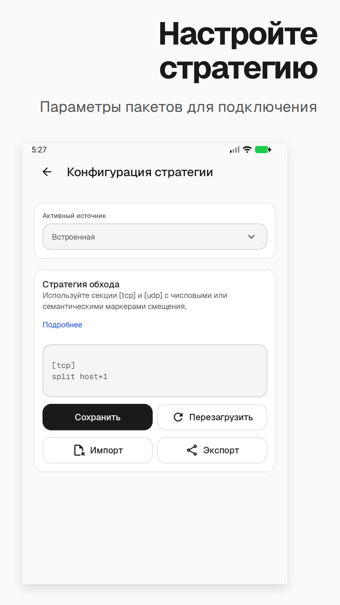
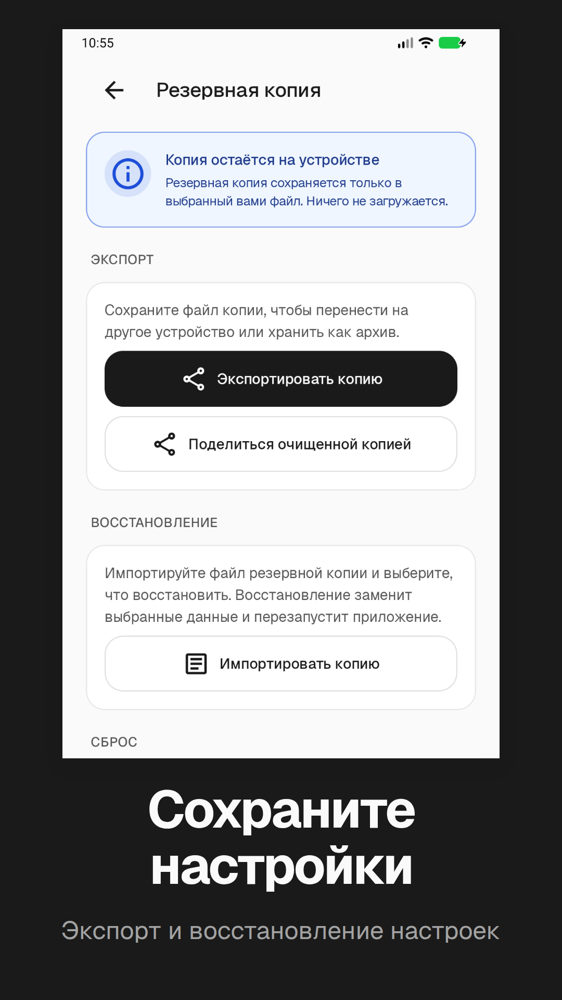

<p align="center">
  <a href="docs/screenshots/ru/feature-graphic.png"></a>
</p>

<p align="center">
  <a href="https://github.com/po4yka/RIPDPI/actions/workflows/ci.yml"></a>
  <a href="https://github.com/po4yka/RIPDPI/releases/latest"></a>
  <a href="LICENSE"></a>
  &nbsp;
  
  
  
</p>

<p align="center"><a href="README.md">English</a> | <b>Русский</b> | <a href="README-es.md">Español</a> | <a href="README-de.md">Deutsch</a> | <a href="README-fr.md">Français</a> | <a href="docs/fa/README.md">فارسی</a> | <a href="README-zh-CN.md">简体中文</a> | <a href="README-hi.md">हिन्दी</a> | <a href="README-pt-BR.md">Português (Brasil)</a></p>

> [!WARNING]
> **Проект находится в активной фазе разработки.** Добавляются новые функции, часто проводятся крупные рефакторинги для повышения качества кодовой базы. В работе активно используются coding-агенты, поэтому в ветке `main` в настоящее время **возможны breaking changes, миграции схем и частично неработающая функциональность**. Если вы столкнулись с регрессией, пожалуйста, [создайте issue](https://github.com/po4yka/RIPDPI/issues) — ваша обратная связь помогает стабилизировать проект.

RIPDPI — это набор инструментов Android для диагностики и оптимизации сетевого пути. Он измеряет, почему цель не работает или деградирует, применяет настраиваемые packet-стратегии на устройстве и может подключаться через relay-серверы, которые вы контролируете. Каждая возможность работает независимо или в сочетании с другими.

## Видеть путь, а не просто переключатель

<p align="center">
  <a href="docs/screenshots/ru/01-hero.png"></a>
  <a href="docs/screenshots/ru/02-diagnostics.png"></a>
</p>

<p align="center">
  <a href="docs/screenshots/ru/03-relays.png"></a>
  <a href="docs/screenshots/ru/04-dns.png"></a>
</p>

<p align="center">
  <a href="docs/screenshots/ru/05-strategies.png"></a>
  <a href="docs/screenshots/ru/06-local-tools.png"></a>
</p>

Материалы для Google Play с настоящими экранами приложения. Нажмите изображение, чтобы открыть его в полном размере. [Захват и экспорт](play-store-screenshots/README.md).

Вместо единой глобальной политики RIPDPI классифицирует каждую цель и каждую сеть отдельно, запоминает проверенные результаты и делает свои вердикты о сбоях видимыми. Начните локально; подключайте relay, только когда прямой путь восстановить нельзя.

## Быстрый старт

Перед выполнением этих команд подготовьте [требования к сборке](#build-requirements), включая toolchain настоящего libXray AAR.

Соберите debug APK для Android из исходного кода:

```bash
git clone https://github.com/po4yka/RIPDPI.git
cd RIPDPI
bash scripts/native/build-libxray.sh
bash scripts/native/verify-libxray-artifacts.sh
./gradlew assembleDebug
```

Прежде чем готовить устройство или release-сборку, прочитайте [требования к сборке и пути результатов](#build-requirements).

## Три возможности, один цикл принятия решений

### Packet-стратегии на устройстве

Применяет настраиваемые преобразования на уровне пакетов на устройстве без маршрутизации трафика через relay-сервер. Root для основного пути не требуется.

Поддерживаемые техники: TCP-сегментация и disorder, инъекция fake-пакетов, OOB (urgent pointer), фрагментация TLS-записей, fake TLS first-flight, вариация QUIC handshake, вариация UDP length-field, вставка IPv6 extension-headers, отправка raw-пакетов через Lua и адаптивные семантические маркеры, разрешающие позицию по live `TCP_INFO`. Strategy chains собираются из Rust-крейтов этого репозитория, без внешнего strategy-бинарника.

Когда relay не настроен, трафик выходит с устройства напрямую — мутации на устройстве являются единственным изменением пути.

### Диагностика

Сканирует каждую цель отдельно и возвращает один из трёх типизированных результатов:

- `TRANSPARENT_WORKS` — проверенный прозрачный путь работает, со стратегиями на устройстве или без них
- `OWNED_STACK_ONLY` — работает только через собственный TLS-стек приложения
- `NO_DIRECT_SOLUTION` — за бюджет этого запуска не найдено успешного прямого решения; можно попробовать relay или другую проверку

Подозрение на блокировку записывается отдельно в `transportClass`, например `IP_BLOCK_SUSPECT`, `SNI_TLS_SUSPECT` или `QUIC_BLOCK_SUSPECT`. Эти классы описывают признаки возможной причины, а не дополнительные варианты результата или доказанную блокировку.

Вердикты сохраняются по network fingerprint и автоматически воспроизводятся при повторном подключении к той же сети. Экран диагностики добавляет TCP- и QUIC-strategy probing из наборов `ripdpi-diagnostics-candidates` (quick/full-matrix), детектирование вмешательства DNS, рекомендации DoH/DoT/DNSCrypt/DoQ-резолверов и экспортируемые архивы диагностики.

### Опциональный VPN-relay

Цепляет трафик локального прокси или VPN через зашифрованные relay-протоколы к серверу, который вы настраиваете:

| Kind / protocol | Integration tier | Scope | Traffic |
| --- | --- | --- | --- |
| `vless_reality` / VLESS Reality TCP | Native relay-core backend (`ripdpi-vless`) | Client relay | TCP + UDP (XUDP) |
| `vless_reality` / xHTTP transport | Native relay-core backend (`ripdpi-xhttp`) | Client relay | TCP |
| `cloudflare_tunnel` | Native xHTTP relay path plus optional Cloudflare publish runtime | Client relay / local-origin publish | TCP |
| `hysteria2` | Native relay-core backend (`ripdpi-hysteria2`) | Client relay | TCP + UDP |
| `tuic_v5` | Native relay-core backend (`ripdpi-tuic`) | Client relay | TCP + UDP |
| `masque` | Native relay-core backend (`ripdpi-masque`): HTTP/2 classic CONNECT for TCP, HTTP/3 CONNECT-UDP for UDP | Client relay | TCP + UDP |
| `shadowtls_v3` | Native relay-core backend (`ripdpi-shadowtls`) with a profile-backed inner relay | Client relay | TCP |
| `trojan` | Native relay-core backend (`ripdpi-trojan`) | Client relay | TCP + UDP |
| `anytls` | Native relay-core backend (`ripdpi-anytls`) | Client relay | TCP + UDP |
| `shadowsocks` | Native relay-core backend (`ripdpi-shadowsocks`) | Client relay | TCP + UDP |
| `tor` | Native Arti-backed relay-core backend (`ripdpi-tor`) with bridge/PT bootstrap | Opt-in client anonymity relay | TCP |
| `naiveproxy` | External helper process (`ripdpi-naiveproxy`) supervised by Android service code | Client relay | TCP |
| `google_apps_script` | In-repository Rust Apps Script relay runtime (`ripdpi-apps-script-core`) selected by `libripdpi-relay.so` | Client relay path | TCP |
| `snowflake` | External Go pluggable-transport binary (`ripdpi-snowflake`) | Client PT relay | TCP |
| `webtunnel` | In-repository Rust pluggable-transport helper binary (`ripdpi-webtunnel`) | Client PT relay | TCP |
| `obfs4` | External pluggable-transport binary (`ripdpi-obfs4`) | Client PT relay | TCP |
| `chain_relay` | Native relay-core composition over referenced relay profiles | Ordered 2-4 hop client relay | TCP |
| `mieru` | Native relay-core backend (`ripdpi-mieru`); UDP relay gated off pending the custom UDP/TCP wire engine | Client relay | TCP |
| `ssh` | Native relay-core backend (`ripdpi-ssh`) | Client relay | TCP |
| `vless` / xHTTP transport | Native relay-core backend (`ripdpi-xhttp`), xHTTP/TLS | Client relay | TCP |

Для обычного `vless` есть нативный backend xHTTP/TLS; остальные транспорты обычного VLESS этот backend не поддерживает. UDP в VLESS Reality использует XUDP только при включённом UDP, транспорте `reality_tcp` и flow `xtls-rprx-vision` или `xtls-rprx-vision-udp443`. xHTTP поддерживает только TCP.

Snowflake намеренно остаётся внешним Go-бинарником; см. [решение об отказе от нативного Rust-варианта Snowflake](docs/architecture/snowflake-native-rust-decision.md). VLESS Reality не использует настоящий ECH; политику только с GREASE см. в [ADR 0001](docs/adr/0001-reality-ech.md).

WARP и AmneziaWG — отдельные поверхности VPN/tunnel-профилей, а не значения `relay_kind` в реестре relay-core.

И режим локального прокси, и режим перенаправления Android VPN работают с настроенным relay или без него.

## Почему такой подход

Современные Android-сети регулярно применяют L7-fingerprinting (TLS JA3/JA4, QUIC), агрессивный QoS в сотовых и общедоступных Wi-Fi сетях, рассинхронизацию MTU и ECN и middlebox-induced TLS handshake aborts — из-за этого одни цели не работают, а другие в той же сети работают нормально. Один глобальный параметр не может покрыть все случаи.

Принцип проектирования RIPDPI: классифицировать каждую цель и каждую сеть отдельно, применять самое лёгкое работающее исправление и запоминать его.

1. **Ответ для каждой цели и каждой сети** — а не единая глобальная политика. Диагностика классифицирует каждый authority и сохраняет вердикт по хешу network fingerprint.
2. **Мутировать локальный путь, когда проблема в сети.** Семантические маркеры, adaptive split placement, fake-payload chains, OOB/disorder, randomized TLS records, вариация QUIC-fingerprint — собираются из in-repo Rust-крейтов.
3. **Откатываться на tunneled relay, когда прямой путь деградирован.** См. матрицу relay выше: она различает native relay-core backends, helper subprocesses, external pluggable transports и отдельные VPN/tunnel profile surfaces.
4. **Честная отчётность.** Вердикты типизированы и отображаются; результаты failure classifier выводятся, а не подавляются; диагностические export bundles редактируют секреты.

## Возможности

- **Режим прокси**: локальный SOCKS5-прокси на настроенном localhost-порте.
- **Режим VPN**: маршрутизирует трафик Android-устройства через локальный мост TUN-to-SOCKS с использованием `VpnService`.
- **Импорт профилей**: единый классификатор обслуживает сканер QR-кодов (камера или сохранённое изображение), буфер обмена и меню «Поделиться» Android (полная версия). Он принимает proxy URI (`vless://`, `ss://`, `trojan://`, `hysteria2://`, `hy2://`, `anytls://`, `tuic://`, `mieru://`, `ssh://`), ссылки на подписку (`https://`, а также ссылки подписки `ripdpi://`, `sing-box://`, NekoBox `sn://`, Clash, v2rayNG и Hiddify), текст `.conf` WireGuard / AmneziaWG, ссылки `amneziawg://` и ключи AmneziaVPN `vpn://`, включая их серию из нескольких QR-кодов. Кнопка **Добавить профиль** в настройках VPN также открывает экран ссылки на подписку и выбор файла `.conf`. Профилями также можно поделиться через QR-код.
- **Ссылки настроек поддержки**: `ripdpi://support-config` и проверенные HTTPS-ссылки поддержки могут показать предварительный просмотр и, после подтверждения пользователя, применить предоставленный службой поддержки патч к любой сохраняемой настройке приложения.
- **Подписки**: форматы подписок base64, Clash / Clash.Meta YAML, sing-box JSON и WireGuard-INI с фоновым автообновлением, обнаружением дублирующихся профилей, группами selector/urltest и доставкой через несколько зеркал.
- **Квитанции миграции сервера**: заменяющая подписка может сохранять точную идентичность доставки. В статусе подписки можно явно проверить заявленный путь замены и поделиться локальной JSON-квитанцией. Reality/Vision, XHTTP и Hysteria2 используют изолированные пробы кандидатов; для AmneziaWG сначала нужно подключить импортированный профиль замены. Квитанции «только получено» и «проверено» различаются; ни одна из них не загружается автоматически.
- **Зашифрованный DNS**: поддержка DoH, DoT, DNSCrypt и DoQ-резолверов в путях, связанных с VPN.
- **Управление стратегиями**: семейства TCP split/disorder/fake, фрагментация TLS-записей и fake-профили, вариация QUIC-handshake, вариация UDP length-field, IPv6 extension headers, Lua `rawsend`, per-step activation filters, контроль IPv4 ID и OOB-инъекция.
- **Память политики по сети**: валидированные per-authority вердикты, индексированные по network fingerprint; автоматически воспроизводятся при переподключении.
- **Адаптивное probing**: автоматическое probing стратегий для впервые увиденных сетей; фоновая `quick_v1` перепроверка при network handover.
- **Перезапуск с учётом handover**: live-переоценка политики при переходах между Wi-Fi, сотовой связью и роумингом.
- **RIPDPI Browser**: собственный браузер приложения для HTTPS-целей, которые требуют собственный TLS-стек; общий путь `SecureHttpClient` для запросов, инициированных приложением.
- **Runtime-телеметрия и логи**: жизненный цикл прокси, решения о маршрутизации, события отказа DNS, прогресс диагностики и события нативного runtime — доступны как история в приложении и экспорт для поддержки.
- **Опциональный root-помощник**: на rooted-устройствах разблокирует операции с raw-сокетами (FakeRst, MultiDisorder, фрагментация IP, полный SeqOverlap, эмиссия raw IPv4/IPv6 пакетов) через привилегированный helper-процесс.

## Режимы выполнения

### Прокси

SOCKS5-прокси на настроенном localhost-порте. Для приложений, которые поддерживают конфигурацию прокси. Strategy-мутации и relay-chaining применяются ко всему трафику, входящему через прокси.

### VPN

Использует Android `VpnService` для перенаправления трафика устройства через локальный движок RIPDPI. Когда relay не настроен, режим VPN применяет мутации на устройстве без изменения egress IP. Когда relay настроен, трафик пересылается зашифрованным до настроенного endpoint.

## Приватность

RIPDPI записывает операционные метаданные для диагностики и устранения неполадок: снимки сети, статус резолвера, решения о маршрутизации, результаты сканирования, состояние сервиса и события нативного runtime.

В обычном режиме RIPDPI не перехватывает пакеты, не сохраняет полезную нагрузку трафика и не записывает TLS-секреты. Расширенный захват пакетов — явно включаемый диагностический инструмент: необработанные байты пакетов хранятся локально с ограниченным сроком хранения и попадают в архив только когда пользователь намеренно делится этим архивом.

Приватность relay-трафика зависит от endpoint relay и профиля, который вы настраиваете.

Цепочки relay с несколькими прыжками содержат упорядоченный список из 2–4 TCP-прыжков (входной, необязательные промежуточные, выходной). Сохраняемая модель профиля, нативная схема передачи (`chainHops`), телеметрия по каждому прыжку и редактор цепочки — все они несут упорядоченный список прыжков, а прежняя двухпрыжковая форма `chainEntry`/`chainExit` сохраняется как обратно совместимое зеркало (hop[0]/hop[last]), поэтому существующие двухпрыжковые конфигурации мигрируют без проблем. Ограничение 2–4 обеспечивается типизированной ошибкой валидации, а не молчаливым усечением. UDP через цепочку намеренно не поддерживается (`udpCapable=false`). Цепочка улучшает защиту от корреляции только когда прыжки находятся в разных доменах доверия; использование одного оператора или юрисдикции для нескольких прыжков создаёт ложное чувство безопасности и показывается в интерфейсе как предупреждение.

## Требования к сборке

Требования: JDK 17, Android SDK (platform `37.1`, CMake `3.31.6`), Android NDK `29.0.14206865`, Rust toolchain `1.98.1`, Android Rust targets для нужных ABI, [`just`](https://just.systems) (task runner; рецепты `justfile` повторяют CI) и [`lefthook`](https://github.com/evilmartians/lefthook) (выполните `lefthook install` один раз, чтобы подключить pre-commit-проверки).

Для упаковки APK в свежем checkout также нужен настоящий libXray AAR с патчами проекта. Подготовьте amd64 Go, закреплённые версии `gomobile` и `gobind`, а также `ANDROID_NDK_HOME` по [инструкции libXray](docs/native/libxray-packaging.md#build). Сборщику нужен новый или пустой каталог `native/xray/artifacts/` и доступ к закреплённым исходникам. Для повторного использования проверенного каталога артефактов, соответствующих текущим версиям, передайте Gradle `-Pripdpi.prebuiltXrayAarDir=/absolute/path/to/artifacts`. Проверка перед упаковкой сохраняется.

Установите нужные пакеты SDK через Android CLI 1.0+:

```bash
android sdk install platforms/android-37.1 ndk/29.0.14206865 cmake/3.31.6
```

```bash
git clone https://github.com/po4yka/RIPDPI.git
cd RIPDPI
bash scripts/native/build-libxray.sh
bash scripts/native/verify-libxray-artifacts.sh
./gradlew assembleDebug
```

Локальные сборки по умолчанию используют `host` (`ripdpi.localNativeAbisDefault`) — ABI определяется по архитектуре хоста (например, `arm64-v8a` на Apple Silicon). Для эмулятора: `./gradlew assembleDebug -Pripdpi.localNativeAbis=x86_64`.

APK создаются в каталогах вариантов, например `app/build/outputs/apk/githubFull/debug/`; задачи и пути release-сборок описаны в [distribution.md](docs/distribution.md).

Локальная debug-сборка использует заглушки запуска Snowflake, obfs4, WebTunnel и помощника публикации Cloudflare. В таком APK эти помощники не передают трафик. Для настоящих helper assets нужны Go и Git в дополнение к Rust/NDK выше, а также доступ к закреплённым репозиториям и модулям Go. Версии Go заданы в [манифесте исходников](native/pluggable-transports/sources.json). Включите строгую обработку ошибок, чтобы сбой сборки помощника остановил сборку:

```bash
./gradlew assembleDebug \
  -Pripdpi.pluggableTransportAssetsMode=source \
  -Pripdpi.pluggableTransportAssetsStrictFailures=true
```

## Тестирование

```bash
./gradlew testDebugUnitTest
bash scripts/ci/run-rust-native-checks.sh
bash scripts/ci/run-rust-network-e2e.sh
./test-lab/scripts/start-lab.sh --profile emulator
./test-lab/scripts/adb-install-debug.sh
./test-lab/scripts/adb-run-probe-emulator.sh --mode diagnostics
./test-lab/scripts/stop-lab.sh
python3 -m unittest scripts.tests.test_offline_analytics_pipeline
```

Подробности: [docs/testing.md](docs/testing.md)

## Документация

**Впервые в RIPDPI?** Рекомендуемый порядок чтения:
[Обзор архитектуры](docs/architecture/ARCHITECTURE.md) →
[режимы выполнения](docs/architecture/RUNTIME_MODES.md) →
[нативный Rust workspace](docs/architecture/NATIVE_RUST.md) →
[JNI-контракт Kotlin/Rust](docs/architecture/JNI_CONTRACT.md) →
[контракты конфигурации](docs/architecture/CONFIG_CONTRACTS.md) →
[руководство по расширению функций](docs/architecture/FEATURE_EXTENSION_GUIDE.md).

- [Native-интеграция и модули](docs/native/README.md)
- [Packet-strategy runtime](docs/packet-strategy-runtime.md)
- [Proxy engine и strategy surface](docs/native/proxy-engine.md)
- [Мост TUN-to-SOCKS](docs/native/tunnel.md)
- [Эксплуатация strategy-pack и TLS catalog](docs/strategy-pack-operations.md)
- [Примеры relay-профилей](docs/relay-profile-examples.md)
- [Импорт конфигурации сервера](docs/server-integration.md)
- [Локальная сетевая тестовая лаборатория](test-lab/README.md)
- [Внешняя автоматизация UI](docs/automation/README.md)
- [Архитектурные заметки](docs/architecture/README.md)
- [Roadmap](ROADMAP.md)

## Перевод RIPDPI

Переводы создаются сообществом через pull request на GitHub. Инструкции по добавлению и улучшению локали находятся в [docs/localization.md](docs/localization.md), а статус и даты проверки — в [реестре происхождения переводов](docs/localization-provenance.md). Структурная проверка не подтверждает языковую точность; арабский, хинди и бразильский португальский ещё ожидают проверки носителем языка.
