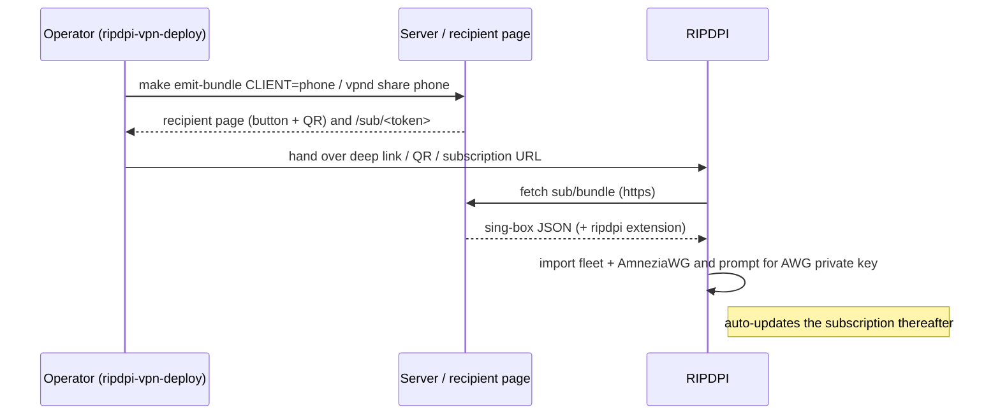

# Importing a Server Configuration

How RIPDPI consumes the connection configuration produced by a server you control. The reference server stack is the sibling `ripdpi-vpn-deploy` repository, whose emitters (`make emit-singbox`, `make emit-bundle`, `vpnd share`) produce the artifacts described here. RIPDPI also imports configuration from any sing-box / Clash.Meta / base64 / WireGuard-INI source, but this document focuses on the owned-server flow.

## The one-tap path (recommended)

The server's recipient page (`vpnd share <client>`) presents an **Add to RIPDPI** card that links to a `ripdpi://` deep link and renders it as a QR code. Tapping the link or scanning the QR opens RIPDPI directly on the import-confirm screen with the whole fleet already parsed. No fields are typed by hand.

### Deep-link contract

```
ripdpi://import?sub=<percent-encoded https subscription URL>
ripdpi://import?url=<percent-encoded https config or bundle URL>
```

- `sub=` enrolls a **subscription**: RIPDPI stores the URL, imports supported profiles after validation, and refreshes it in the background (rotation, new cohorts, and burned-IP replacements arrive automatically).
- `url=` performs a **one-shot** import of a single remote config or bundle. It is stored as a bootstrap group and is *not* re-fetched by the auto-update worker.

The target is percent-decoded and must be `https://`. Malformed or non-https input falls through to the normal import-error UX without crashing. The intent filter is handled by `ImportHandlerActivity`; the parsing contract lives in `RipDpiImportDeepLinkParser`.

## Import surfaces

| Surface | How | Best for |
| --- | --- | --- |
| `ripdpi://` deep link | tap the recipient-page button | same-device handoff, one tap |
| QR code | scan the recipient-page QR (or any link, `.conf`, or AmneziaVPN key below) with RIPDPI | phone-to-phone, printed handoff |
| Subscription URL | VPN settings → **Add profile** → **Subscription**, then paste `https://<host>/sub/<token>`; a `/bootstrap/` path is treated as a one-time link | manual entry, fleet + auto-update |
| Other clients' subscription links | `sing-box://import-remote-profile?url=…#name`, NekoBox `sn://subscription`, `clash://install-config`, `v2rayng://install-sub`, `hiddify://install-config` | links already published for other clients |
| WireGuard / AmneziaWG config | VPN settings → **Add profile** → **WireGuard / AmneziaWG from file**, the share sheet, the clipboard, or a QR of the `.conf` text; opens the AmneziaWG editor prefilled | an AmneziaVPN or WireGuard export |
| AmneziaVPN key | `vpn://…` text or AmneziaVPN's multi-code QR series; RIPDPI extracts the WireGuard / AmneziaWG config | an AmneziaVPN share |
| Single share link | `vless://…`, `hysteria2://…`, `amneziawg://…` via QR, clipboard, or share sheet | a single profile |

RIPDPI does not import a sing-box / RIPDPI bundle JSON from a local file or the clipboard; deliver bundles through a subscription URL.

## Shipping a preloaded app

A build can carry a preset so that a recipient installs the standard app and finds servers, routing rules, and settings already in place. The preset is a backup document without credentials. It carries one or more bootstrap token slots: groups whose subscription is a `/bootstrap/<token>` link that the app has not consumed. The app restores the preset once, on the first launch of a fresh install, before the first screen appears. Then it consumes each slot and stores the delivered servers in Keystore-sealed storage.

1. Configure the app on a device or emulator the way the recipient must find it: set routing rules and settings, and complete onboarding. Do not add servers or subscriptions; the preparation step refuses them because they carry credentials.
2. Export a backup with credentials (Settings → Backup → Full) and copy the archive to the build machine. A FULL export is the only export that keeps a subscription link.
3. Add the token slot. The app consumes a `/bootstrap/<token>` link when you import it, so the slot cannot come from the app. Get a new bootstrap link from the server, and put a group like this in the `groups` list of the plaintext document:

   ```json
   {"id": "preset-relay", "name": "Relay", "type": "SUBSCRIPTION", "order": 0, "isSelector": false,
    "subscription": {"link": "https://<server>/bootstrap/<token>", "kind": "BOOTSTRAP"}}
   ```

   The archive can be the plaintext JSON document. A document with only `schemaVersion`, `createdAtEpochMillis`, `appVersion`, `profiles: []`, `groups`, `rules: []`, and `settings: {}` is also valid; an empty `settings` map keeps the default settings.
4. Convert the archive into the preset asset. The passphrase is read from the environment and is not stored; a plaintext archive needs no passphrase:

   ```bash
   RIPDPI_PRESET_PASSPHRASE='<export passphrase>' ./gradlew :app:preparePreset -Pripdpi.presetArchive=<path to archive>
   ```

   The task removes `privateData` and writes `containsCredentials: false`. It writes nothing when the document has profiles, group members, a subscription that is not an unconsumed `BOOTSTRAP` link, or no token slot.
5. Build the app as usual. Every variant packages `app/src/main/assets/preset.json` when the file exists.

Rules the app follows:

- The preset applies only when onboarding is not complete and no preset was applied before. An existing install that updates to a preset build keeps its data.
- The recipient still sees onboarding. The interface, mode, and DNS steps do not appear, because the preset holds those choices. Three steps take their place: they tell the recipient that the app is ready, how to connect, and what to do when the connection fails. Onboarding does not change the preset settings, unless the recipient accepts a different mode after a failed connection test.
- The app never applies a preset twice and never overwrites user edits. The app does not refresh a consumed bootstrap slot; to change servers after delivery, give the recipient a long-lived subscription link.
- If the server cannot be reached on the first launch, the slot stays unconsumed and the app tries again on the next launch.
- A full reset returns the install to the preset.
- A preset the app cannot read is ignored whole. The app records a startup warning and opens as a build without a preset.

The preset is plaintext inside the APK and carries no credentials, but anyone who holds the APK can read its bootstrap links. Each link works once: the first install that consumes it gets the servers, and later installs get an "already consumed" result. One APK therefore serves one recipient per token slot. The asset path is gitignored; do not attach a preset build to a public release.

## What each artifact carries

| Capability | `vless://` line | sing-box subscription | RIPDPI bundle |
| --- | --- | --- | --- |
| One VLESS REALITY profile (pbk/sid/sni/flow/fp/xhttp) | yes | yes | yes |
| Whole fleet (P0 + P1 + P2) | no | yes | yes |
| Selector + urltest failover | no | yes | yes |
| Background auto-update | no (single line) | yes (via subscription URL) | yes (via subscription URL) |
| Hysteria salamander obfs / insecure | yes (`hysteria2://`) | yes | yes |
| Hysteria port-hop | no | rejected | rejected |
| AmneziaWG device-VPN | via `amneziawg://` only | no | yes |

VLESS REALITY parameters round-trip in full from a `vless://…?security=reality&pbk=…&sid=…&sni=…&flow=…` link and from a sing-box `tls.reality` outbound. Hysteria2 salamander obfuscation and insecure TLS flags import from `hysteria2://`, Clash.Meta, sing-box, and RIPDPI bundles; port-hopping is rejected for this recipient. The AmneziaWG device-VPN is carried by `amneziawg://` or the RIPDPI bundle. See [Relay profile examples — Import Coverage vs Relay Settings](relay-profile-examples.md) for the per-protocol detail.

## The RIPDPI bundle

The RIPDPI bundle is a normal sing-box JSON document with one additional top-level `ripdpi` object:

```jsonc
{ /* standard sing-box: log, dns, inbounds, outbounds, route */
  "ripdpi": {
    "schema_version": 3,
    "amneziawg": [
      { "tag": "p2-awg-phone", "address": ["10.66.66.2/32"], "dns": ["1.1.1.1", "1.0.0.1"],
        "mtu": 1420, "jc": 4, "jmin": 40, "jmax": 70, "s1": 50, "s2": 100,
        "h1": 1, "h2": 2, "h3": 3, "h4": 4, "private_key_placeholder": true,
        "peer": { "public_key": "…", "preshared_key": "…", "endpoint": "203.0.113.10:51820",
                  "allowed_ips": ["0.0.0.0/0", "::/0"], "persistent_keepalive": 25 } }
    ],
    "hysteria_extras": {
      "p2-hysteria2-<host>": { "obfs": { "type": "salamander", "password": "…" },
                               "insecure": false }
    },
    "endpoints": {
      "p2-hysteria2-<host>": { "health": { "status": "degraded",
                                           "observed_at": "2026-11-19T10:00:00Z", "ttl_seconds": 900 } }
    },
    "field_report": { "endpoint": "https://reports.example.test/v1/field-report",
                      "cohort_token": "…", "max_reports_per_day": 4 }
  }
}
```

`SingBoxSubscriptionParser` parses the standard outbounds first, then reads the `ripdpi` block, which must declare `schema_version == 3`. `amneziawg[]` entries become AmneziaWG profiles; `hysteria_extras` entries are matched to their Hysteria2 outbound by `tag` and carry the salamander obfs password onto that profile. Any other `schema_version`, including 2, and a missing one reject the whole bundle with the typed `UNSUPPORTED_SCHEMA_VERSION` error; there is no compatibility path for version 2 bundles, so regenerate them with the current deployer. The nested `payload_failover` object keeps its own `schema_version` 2. Compatibility with other clients depends on their version and supported outbound types. Validate a bundle for its intended recipient; clients that ignore the `ripdpi` key cannot activate its AmneziaWG profiles.

The deploy repository owns the **executable JSON Schema** `contract/ripdpi-bundle.schema.json` (prose companion: `docs/RIPDPI-BUNDLE.md`). A copy is vendored at `core/data/src/test/resources/contract/` and validated locally by `RipdpiBundleContractTest`. The repositories do not compare their copies in every CI run, so a release update must verify byte identity or run the cross-repository emit/validate/app-parse gate. Version 3 adds two optional blocks:

- **`endpoints.<server_ref>.health`** — server-observed `status` (`healthy`, `degraded`, `down`, `unknown`), `observed_at` (RFC 3339 UTC) and `ttl_seconds` (60 to 86400), keyed by the opaque `server_ref`, which is an outbound or AWG tag of the same bundle. The selector group stores every member with its health, and failover evaluates the health on each probe pass: an unexpired `down` endpoint is not a candidate, `degraded` moves after the neutral candidates, and `healthy`, `unknown`, missing, and expired health (`observed_at + ttl_seconds` has passed on the device clock) are neutral and keep the declared order. An expired `down` endpoint therefore returns as a candidate without a refresh. Health is advisory: when every candidate is down the import still succeeds, failover uses all members in declared order, and the import result reports the typed outcome `EndpointHealthOrder.AllDownFailOpen`. An entry with an invalid key, status, instant, or ttl is dropped, so that endpoint stays neutral. A server-client clock skew up to the ttl is tolerated.
- **`field_report`** — `endpoint` (an `https://` URL), `cohort_token`, and `max_reports_per_day` (1 to 24) for the opt-in field-report client. An invalid block rejects the bundle with the typed `INVALID_FIELD_REPORT` error that names the field.

The parser also surfaces these optional fields:

- **`amneziawg[].cohort_fingerprint`** — `"sha256:…"` over the resolved obfuscation params; `AmneziaWgParameters.cohortFingerprint()` recomputes it, so a bundle whose params have drifted from the server's current cohort is detectable up front instead of stalling the AWG handshake.
- **`hysteria_extras.<tag>.salamander_upstream_tag`** — the server's Hysteria2 release; compare to the bundled obfuscator version to warn on a Salamander skew.
- **`topology`** — `split_hop_egress` / `hysteria_realm`.
  - `hysteria_realm` is the realm id of the bundle's Hysteria2 endpoints. Import stores it on each Hysteria2 profile, and it reaches the native relay config as `hysteriaRealmId`. It also supplies `realm_id` for a Hysteria2 outbound whose `realm` block omits it; a different id in the block rejects the bundle.
  - `split_hop_egress` needs no client action. No production code compares the observed exit address with the server address of the active profile (checked 2026-11-20), so an exit that differs from the entry host is not reported as a fault. Keep it that way: an exit-address check added later must skip the comparison when this flag is true.
- **`expires`** — date-only or RFC-3339 instant normalized onto `SingBoxParseResult.Success.tokenExpiresAtEpochMillis`; the client persists it separately from `Subscription-Userinfo` credential expiry, warns seven days ahead, and stops automatic refresh after the enforcement point without deleting imported profiles.

## The one manual step: AmneziaWG device key

The emitted bundle must not contain a usable AmneziaWG **device private key**. It marks the field with `private_key_placeholder: true`; after import, the AmneziaWG editor prompts for the matching key out of band. Generation and retention provenance belongs to the operator workflow and is not proved by this repository.

**Recovery (no local key).** When `private_key_placeholder` is `true` but the device has no stored key — a fresh install, a device migration, or cleared app data — the parser does **not** fail: it imports the AmneziaWG profile with an empty private key, and the profile stays inactive until you supply the key. The subscription itself remains valid; only the device key is missing. The fix is the same out-of-band handoff as the first time: the operator re-issues the key with `new-client.sh` and sends it over Signal/QR, and you paste it into the AWG editor. The full state machine and codes (`KEY_PRESENT`, `KEY_MISSING_REPROVISION`, `KEY_REJECTED`, `PLACEHOLDER_ABSENT_NO_KEY`) are specified in `ripdpi-vpn-deploy` `docs/RIPDPI-BUNDLE.md` → "Private-key recovery flow".

## After import

- **New subscriptions auto-update.** A background worker is scheduled after the first refresh attempt. Existing subscriptions keep their saved auto-update preference, including an opt-out. Terminal expiry or revocation stops refresh.
- **One-shot (`url=`) imports do not refresh.** Re-import to pick up server changes.
- **Failover is automatic.** The selector/urltest groups in the sing-box document let the client move between P0/P1/P2 as reachability changes.

## Server migration receipts

A replacement bundle may include `ripdpi.migration` with schema version `1`,
opaque migration and delivery UUIDs, declared target tags, a receipt key and an
`awg_previous_tags` map. The shared schemas and HMAC vectors are vendored under
`core/data/src/test/resources/contract/`. The client validates the extension,
hashes the exact UTF-8 response bytes and records receipt authority only after
successfully persisting the imported profiles. Invalid refreshes keep the
previous delivery; a successful metadata-free refresh clears its authority.
An unchanged delivery and exact target configuration retain a prior test.

For AmneziaWG, `awg_previous_tags` maps a new target tag to its previous published
tag. The importer carries the locally stored private key and existing local
overrides only from that origin within the same subscription group. It preserves
the old row and replaces delivered server fields in the new row. It never borrows
a key from another subscription. A device without the old key still requires the
private-key recovery flow above.

Open **Subscription status** to test a declared replacement path. Enter an
HTTP(S) test URL. Reality/Vision, XHTTP and Hysteria2 use an isolated candidate
runtime and require a successful full-body HTTP probe. For AmneziaWG, connect the
imported replacement profile first: the test requires that exact active runtime
configuration and rejects session or network changes. Delivery changes, local
profile edits, cancellation and stale results cannot upgrade a receipt.

**Share migration receipt** explicitly exports a small JSON file through the
Android share chooser. A `received` receipt proves possession of the imported
delivery; `path-tested` additionally records one successfully tested target and
time. The HMAC binds those fields to the delivery and exact payload digest. It
is a possession proof, not tamper-resistant device attestation or a promise that
every application works. Export omits credentials, endpoints, local profile IDs,
network identifiers and the receipt key. Nothing is uploaded automatically.

## HTTPS upload diagnostic

For **Diagnostics → Verified HTTPS upload**, provide an HTTPS endpoint with a certificate that the app trusts. The URL can include a port and path. Keep it free of credentials, a query, and a fragment.

- The app sends one POST with `Content-Type: application/octet-stream` and a `Content-Length` from 1 to 1,048,576. The body contains generated test data.
- Read the full request body. Count the bytes and compute the SHA-256 of those bytes. After the full read, return HTTP 200 with a JSON body of at most 512 bytes. Use an integer in `bytes` and a 64-digit hexadecimal string in `sha256`.
- For example, if the server receives the two bytes `ok`, the receipt is `{"bytes":2,"sha256":"2689367b205c16ce32ed4200942b8b8b1e262dfc70d9bc9fbc77c49699a4f1df"}`.

## ECH transfer comparison

For **Diagnostics → ECH transfer comparison**, use an HTTPS URL with a DNS host and give the app one IP address for that origin. All three requests use the chosen address and port. Use a certificate that the app trusts with TLS 1.3 and HTTP/1.1 enabled.

- Serve the same body of 1 to 32,768 bytes for each request. Return HTTP 200 with identity encoding. Enter the exact size and SHA-256 in the app.
- Publish an ECH configuration in the origin's DNS HTTPS record and enable ECH reception on the chosen IP for the real ECH leg. For a non-default port such as 8443, publish the record at `_8443._https.<host>`. The app reports an absent configuration separately from a handshake failure.

## Deployment protocol boundaries

The recipient contract below was checked against `ripdpi-vpn-deploy`
`794202c393648986ceea7afd7d022933fbe44dce`. The server's
`ansible/role-tiers.yml` and `scripts/client_payload.py` define the scope.
Import coverage does not prove a connection on an Android device.

| Server surface | RIPDPI recipient boundary |
| --- | --- |
| VLESS REALITY + Vision | Export and import preserve UUID, public key, short ID, SNI, fingerprint and flow. Finalmask and Mux.Cool are rejected by the server exporter. |
| VLESS XHTTP direct and alternate | The exporter permits `auto` and `stream-up` without tuning. Each endpoint retains its TLS identity. |
| CDN-front XHTTP | A VLESS XHTTP outbound whose `server`, TLS name and `transport.host` are the CDN host name imports as a selectable member; the app resolves that name on the underlying network and never needs the origin address. The recipient exporter does not emit the endpoint. Not checked against a live CDN. |
| Hysteria2 + Salamander | Single UDP port with the supported bandwidth profile. The exporter rejects port hopping, ECH and BBR resource profiles. |
| AmneziaWG | Imported through `ripdpi.amneziawg`, a `.conf` (file, QR, clipboard, share sheet), an `amneziawg://` link, or an AmneziaVPN `vpn://` key. A plain WireGuard `.conf` becomes an AmneziaWG profile with no obfuscation. Only the first `[Peer]` is used. AmneziaWG 3.x keys (header protection, content padding, random trailers, timer ranges) are carried to the native engine. Activation requires a valid device key and an ABI-compatible parameter set. Non-zero `S3`/`S4`, which 3.x header protection needs, import and start like other parameters. |
| NaiveProxy | A sing-box `naive` outbound and a `naive+https://` or `naive+quic://` link import as a selectable NaiveProxy profile. The helper dials `server` and verifies that name, so the TLS name must equal `server`. A node with any other TLS option (private CA, ECH, `insecure`), UDP over TCP, QUIC tuning, or an invalid port, credential, header or concurrency stays an inactive raw profile; a node with `detour` or `multiplex` is skipped. The recipient exporter emits only the link, in its private `native` delivery, and no bundle outbound. Not checked against a live server. |
| Snell v4/v6 | The `v4-stream` member with `reuse: false` (client version 4, `obfs_mode: none`, TCP) imports as a selectable `snell` relay. The native client in `ripdpi-snell` is a port of `sagernet/sing-snell` `bc5a12ac`, the version that the role's sing-box `v1.14.3` pins. It has no UDP and no connection reuse. The `reuse: true` members and the Snell v6 members (`mode: default` and `mode: unshaped`) stay inactive raw profiles. No device test against a deployed Snell server has run. |
| DNS-morph | The app speaks the RIPDPI DNS-Morph v2 delivery channel below when a bundle declares `ripdpi.dns_morph`. The deploy role still runs an unnamed self-built binary that forwards to `upstream_endpoint` and exports no `dns_morph` block, so no deployed server speaks v2 yet. |
| Hysteria realm | The client implements the realm client side of sing-box `v1.14.0-alpha.22`: STUN discovery, `POST /v1/{realm}/connect`, UDP hole punch, then Hysteria2 on the punched socket. It runs when a Hysteria2 outbound carries the upstream `realm` block (`server_url`, `token`, `realm_id`, `stun_servers`). The deployment bundle emits only `topology.hysteria_realm`, and no deployment role registers a Hysteria2 server in the realm, so a deployment bundle still dials its Hysteria2 server directly. Not verified against a live realm service or a real NAT. See [Hysteria realm](#hysteria-realm). |
| Probe matrix: VLESS XHTTP, Trojan TCP/TLS | Profile types exist, but these research listeners need separate profiles and connection checks. |
| Probe matrix: Trojan XHTTP, MTProto, TLS control | Trojan XHTTP is rejected at import as an unsupported transport. The native XHTTP carrier sends a VLESS request and removes a VLESS response header, and the relay configuration has no transport field for Trojan. The server uses this listener only as a measurement target for `vpnd probe-matrix`; the recipient exporter does not emit it. MTProto and the TLS control listener are not VPN subscription profiles. |
| Server WARP, split-hop, cascade, tailnet | Server egress, topology or management functions. Client compatibility depends on the public ingress protocol. |

The importer resolves the outer selector and bounded nested groups. It rejects
cycles, duplicate tags, missing references, ambiguous roots and incompatible
probe policies. Supported candidates remain available in a mixed Snell bundle.
A default that resolves only to unsupported candidates is rejected. An invalid
relay selection cannot become an AWG-only success that deletes working relay
members. A genuine AWG-only bundle can replace relay members.

SHARE backups remove the entire subscription URL, bearer token and mirrors.
A URL path or hostname can itself contain a credential. FULL backups retain
these values and must be treated as credential-bearing exports.

## DNS-Morph bootstrap channel

DNS-Morph v2 is a reserve delivery path for a long-lived subscription. It is
not a traffic tunnel. When every HTTPS endpoint of a refresh fails, the app
asks the bridge for the subscription body over UDP. Only the subscriber that
holds the token can get an answer, an observer cannot read the body, and the
app installs it only if the bridge's Ed25519 signature verifies. The channel
is off unless the latest accepted bundle declares it. Bootstrap (single-use)
subscriptions never use it. The client is `native/rust/crates/ripdpi-dns-morph`
(`fetch`); its `Responder` is the bridge side and the reference for a server
build.

The bundle declares the bridge in the versioned `ripdpi` block. All five
fields are required and unknown fields reject the bundle:

```json
"dns_morph": {
  "address": "192.0.2.53",
  "port": 53,
  "zone": "m.example.net",
  "public_key": "<standard base64 of the bridge's 32-byte Ed25519 public key>",
  "token": "<standard base64 of a 32-byte secret unique to this subscriber>"
}
```

`address` is an IP literal, so the channel never needs a name lookup. `zone`
is at most 54 characters so that every reply stays under 512 bytes. The token
is a credential: it is stored sealed with the subscription, never logged, and
dropped from backups with the other delivery endpoints. A bundle without the
block turns the channel off at its next accepted refresh.

Wire format, version 2:

1. The client opens one UDP socket, protects it when the VPN protection
   callback is registered, connects it to `address:port`, and generates a
   fresh X25519 key pair for the whole fetch.
2. For chunk `i` (0, 1, 2, ...) it sends a standard query, `QTYPE=TXT`,
   `QCLASS=IN`, random ID, for `<l1>.<l2>.<zone>`. The 55 request bytes are
   version `0x02`, the client X25519 public key (32), the current minute
   since the Unix epoch as a big-endian `u32`, `i` as a big-endian `u16`,
   and a 16-byte MAC: the first 16 bytes of HMAC-SHA256 under the MAC
   key over those 39 bytes followed by the zone in lowercase ASCII with its
   trailing dot. They are encoded as lowercase base32hex without padding (RFC 4648 section 7);
   `l1` holds the first 63 characters and `l2` the remaining 25. The bridge
   decodes labels case-insensitively.
   Two subkeys come from the token: HKDF-SHA256(salt empty, IKM token) expanded
   with info `"ripdpi-dns-morph-v2 query mac"` gives the MAC key, and with
   info `"ripdpi-dns-morph-v2 payload salt"` gives the payload salt. A zero
   token is invalid.
3. The bridge drops a query whose minute is more than 5 minutes from its own
   clock in either direction, so a captured query cannot be replayed later
   to probe the bridge; the device clock must be within that window. It then
   finds the subscriber whose token gives the same MAC
   (constant-time compare). A request without a matching token is not
   answered by this protocol: the bridge forwards it to its local resolver
   like any other query, so a prober cannot tell the bridge apart.
4. The envelope is `bridge_x25519_public (32) || nonce (12) || ciphertext ||
   signature (64)`. The bridge X25519 key is HKDF-SHA256(salt empty, IKM the
   Ed25519 seed, info `"ripdpi-dns-morph-v2 bridge x25519"`). From
   HKDF-SHA256(salt payload salt, IKM the X25519 shared secret), the info
   `"ripdpi-dns-morph-v2 payload key" || client_public || bridge_public` gives
   the AEAD key and `"ripdpi-dns-morph-v2 nonce key" || client_public ||
   bridge_public` gives the nonce key. The nonce is the first 12 bytes of
   HMAC-SHA256(nonce key, payload), so it is the same for every chunk of one
   fetch and reveals nothing about the payload. The ciphertext is
   ChaCha20-Poly1305 of the payload with the client public key as associated
   data. The signature is Ed25519 over
   `"ripdpi-dns-morph-v2\0" || client_public || everything before it`.
5. The bridge answers with the same ID and question, `NOERROR`, and exactly
   one TXT record with one character-string: the envelope length as a
   big-endian `u32`, `i` as a big-endian `u16`, then envelope bytes
   `[180*i, 180*i+180)`. A request past the envelope gets `REFUSED`.

The client fails closed: a datagram over 512 bytes, a declared envelope over
64 KiB of payload, a changed length, a wrong chunk index or size, a non-
`NOERROR` code, a bad signature or a failed decryption ends the fetch. It
ignores datagrams that do not match the query ID and question. Each chunk gets
three 2-second attempts within a 90-second budget. A full 64 KiB payload takes
about 365 round trips, so it fits the budget only below about 245 ms per round
trip; keep the served bundle small. A failed fetch keeps the HTTPS failure and
the last working members. The channel has no forward secrecy against a later
leak of the bridge seed, and a client that loses its token loses the channel.

A captured query can be replayed only inside its 5-minute window. A replay
reveals nothing, because only the client's discarded X25519 secret opens the
reply, but it costs the bridge one seal per query and gives about 3x
reflection with a spoofed source. Each query also costs one HMAC per
subscriber. A bridge must rate-limit DNS-Morph answers per source address and
may cache the envelope per client key for the length of one fetch. A bridge
rejects duplicate tokens.

Deploy-side work before a live check: build the bridge from `Responder` (or a
reimplementation tested against it), give it one signed payload per subscriber
instead of `upstream_endpoint`, issue each subscriber a random 32-byte token,
and export the `dns_morph` block with the public key derived from
`dns_morph_bridge_secrets.signing_key` and that subscriber's token. A device
check then needs that bridge reachable on UDP/53 from the test network, a
bundle that declares it, and a refresh with the HTTPS endpoints blocked.

## Hysteria realm

A realm profile reaches a Hysteria2 server that has no fixed address. The client asks its STUN servers for the public address of its QUIC socket, sends that address with a random nonce and obfuscation key to the rendezvous service, receives the server's addresses, exchanges punch packets with them, and then runs the normal Hysteria2 handshake on the same socket. The rendezvous service never carries VPN traffic.

Import reads the upstream sing-box outbound shape. `server`, `server_port` and `server_ports` must be absent, as upstream requires:

```json
{
  "type": "hysteria2",
  "tag": "p5-realm",
  "password": "<hysteria2 password>",
  "tls": { "enabled": true, "server_name": "peer.example" },
  "realm": {
    "server_url": "https://realm.example.com:8444",
    "token": "<realm user token>",
    "realm_id": "realm-a",
    "stun_servers": ["stun.example.com:3478"]
  }
}
```

Limits of the client:

- The rendezvous URL must use `https`. `http` is accepted for a loopback host only, because the request carries the token. `realm.http_client` is ignored, so the service needs a publicly trusted certificate; the profile's `insecure` flag and pin apply to the Hysteria2 server only.
- Rendezvous is IPv4 only.
- The client punches only public peer addresses that the service names (at most 16), accepts a punch reply only from those hosts, and rejects an answer whose nonce or obfuscation key differs from the ones it sent.
- A realm profile cannot use port hopping and does not migrate its QUIC path after the handshake.
- A profile that has a realm id but no rendezvous URL dials its server address directly.
- The connection editor has no realm fields. A realm profile comes from an import.
- A `hysteria2://` link cannot carry realm settings.

What the deployment must add before a deployment bundle can use a realm: emit the `realm` block (rendezvous URL, token, STUN servers) on the Hysteria2 outbound, and run a Hysteria2 server that registers in the realm. The deployment's Hysteria2 role runs the reference server, which does not register.

## End-to-end flow



## Troubleshooting

- **Tapping the link does nothing** — confirm RIPDPI is installed and the link is `ripdpi://import?...` with an `https` target; an `http` target is rejected.
- **REALITY profile imports but will not connect** — verify the server's `serverName`/`pbk`/`sid` match; these now travel with the profile, so a mismatch means the server pin changed (re-emit and re-import, or rely on subscription auto-update).
- **AmneziaWG shows "no private key"** — paste the device private key from client creation; it is intentionally not in the bundle.
- **Hysteria connects without obfuscation** — confirm the source contains `obfs=salamander` plus `obfs-password` for a URI, `obfs-password` for Clash.Meta, or `obfs.password` for sing-box; then re-import and inspect the profile.

## See also

- [Relay profile examples](relay-profile-examples.md) — per-protocol import coverage and relay-config field reference.
- `ripdpi-vpn-deploy` `docs/reference/client-notes.md` — the server-side counterpart (how operators produce and deliver these artifacts).
- `ripdpi-vpn-deploy` `docs/RIPDPI-BUNDLE.md` — authoritative bundle schema.
