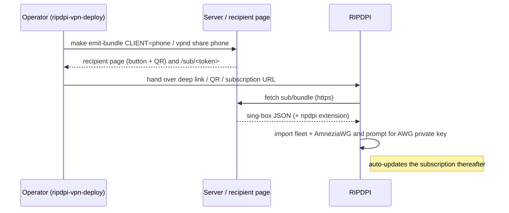

# Importing a Server Configuration

How RIPDPI consumes the connection configuration produced by a server you control. The reference server stack is the sibling `ripdpi-vpn-deploy` repository, whose emitters (`make emit-singbox`, `make emit-bundle`, `vpnd share`) produce the artifacts described here. RIPDPI also imports configuration from any sing-box / Clash.Meta / base64 / WireGuard-INI source, but this document focuses on the owned-server flow.

## The one-tap path (recommended)

The server's recipient page (`vpnd share <client>`) presents an **Add to RIPDPI** card that links to a `ripdpi://` deep link and renders it as a QR code. Tapping the link or scanning the QR opens RIPDPI directly on the import-confirm screen with the whole fleet already parsed. No fields are typed by hand.

### Deep-link contract

```
ripdpi://import?sub=<percent-encoded https subscription URL>
ripdpi://import?url=<percent-encoded https config or bundle URL>
```

- `sub=` enrolls a **subscription**: RIPDPI stores the URL, imports supported profiles after validation, and refreshes it in the background (rotation, new cohorts, and burned-IP replacements arrive automatically).
- `url=` performs a **one-shot** import of a single remote config or bundle. It is stored as a bootstrap group and is *not* re-fetched by the auto-update worker.

The target is percent-decoded and must be `https://`. Malformed or non-https input falls through to the normal import-error UX without crashing. The intent filter is handled by `ImportHandlerActivity`; the parsing contract lives in `RipDpiImportDeepLinkParser`.

## Import surfaces

| Surface | How | Best for |
| --- | --- | --- |
| `ripdpi://` deep link | tap the recipient-page button | same-device handoff, one tap |
| QR code | scan the recipient-page QR with RIPDPI | phone-to-phone, printed handoff |
| Subscription URL | paste `https://<host>/sub/<token>` into Add Subscription | manual entry, fleet + auto-update |
| Config / bundle file or text | share-sheet, clipboard, or QR of a sing-box / RIPDPI bundle JSON | offline, air-gapped handoff |
| Single share link | `vless://…`, `hysteria2://…`, `amneziawg://…` | a single profile |

## What each artifact carries

| Capability | `vless://` line | sing-box subscription | RIPDPI bundle |
| --- | --- | --- | --- |
| One VLESS REALITY profile (pbk/sid/sni/flow/fp/xhttp) | yes | yes | yes |
| Whole fleet (P0 + P1 + P2) | no | yes | yes |
| Selector + urltest failover | no | yes | yes |
| Background auto-update | no (single line) | yes (via subscription URL) | yes (via subscription URL) |
| Hysteria salamander obfs / insecure | yes (`hysteria2://`) | yes | yes |
| Hysteria port-hop | no | rejected | rejected |
| AmneziaWG device-VPN | via `amneziawg://` only | no | yes |

VLESS REALITY parameters round-trip in full from a `vless://…?security=reality&pbk=…&sid=…&sni=…&flow=…` link and from a sing-box `tls.reality` outbound. Hysteria2 salamander obfuscation and insecure TLS flags import from `hysteria2://`, Clash.Meta, sing-box, and RIPDPI bundles; port-hopping is rejected for this recipient. The AmneziaWG device-VPN is carried by `amneziawg://` or the RIPDPI bundle. See [Relay profile examples — Import Coverage vs Relay Settings](relay-profile-examples.md) for the per-protocol detail.

## The RIPDPI bundle

The RIPDPI bundle is a normal sing-box JSON document with one additional top-level `ripdpi` object:

```jsonc
{ /* standard sing-box: log, dns, inbounds, outbounds, route */
  "ripdpi": {
    "schema_version": 1,
    "amneziawg": [
      { "tag": "p2-awg-phone", "address": ["10.66.66.2/32"], "dns": ["1.1.1.1", "1.0.0.1"],
        "mtu": 1420, "jc": 4, "jmin": 40, "jmax": 70, "s1": 50, "s2": 100,
        "h1": 1, "h2": 2, "h3": 3, "h4": 4, "private_key_placeholder": true,
        "peer": { "public_key": "…", "preshared_key": "…", "endpoint": "203.0.113.10:51820",
                  "allowed_ips": ["0.0.0.0/0", "::/0"], "persistent_keepalive": 25 } }
    ],
    "hysteria_extras": {
      "p2-hysteria2-<host>": { "obfs": { "type": "salamander", "password": "…" },
                               "insecure": false }
    }
  }
}
```

`SingBoxSubscriptionParser` parses the standard outbounds first, then reads the `ripdpi` block when `schema_version == 1`. `amneziawg[]` entries become AmneziaWG profiles; `hysteria_extras` entries are matched to their Hysteria2 outbound by `tag` and carry the salamander obfs password onto that profile. An unknown `schema_version` is ignored — the sing-box outbounds still import. Compatibility with other clients depends on their version and supported outbound types. Validate a bundle for its intended recipient; clients that ignore the `ripdpi` key cannot activate its AmneziaWG profiles.

The deploy repository owns the **executable JSON Schema** `contract/ripdpi-bundle.schema.json` (prose companion: `docs/RIPDPI-BUNDLE.md`). A copy is vendored at `core/data/src/test/resources/contract/` and validated locally by `RipdpiBundleContractTest`. The repositories do not compare their copies in every CI run, so a release update must verify byte identity or run the cross-repository emit/validate/app-parse gate. `schema_version` stays `1`: post-1 fields are additive and optional. The parser surfaces them too:

- **`amneziawg[].cohort_fingerprint`** — `"sha256:…"` over the resolved obfuscation params; `AmneziaWgParameters.cohortFingerprint()` recomputes it, so a bundle whose params have drifted from the server's current cohort is detectable up front instead of stalling the AWG handshake.
- **`hysteria_extras.<tag>.salamander_upstream_tag`** — the server's Hysteria2 release; compare to the bundled obfuscator version to warn on a Salamander skew.
- **`topology`** — `split_hop_egress` / `hysteria_realm`, surfaced on `SingBoxParseResult.Success.topology`.
- **`expires`** — date-only or RFC-3339 instant normalized onto `SingBoxParseResult.Success.tokenExpiresAtEpochMillis`; the client persists it separately from `Subscription-Userinfo` credential expiry, warns seven days ahead, and stops automatic refresh after the enforcement point without deleting imported profiles.

## The one manual step: AmneziaWG device key

The emitted bundle must not contain a usable AmneziaWG **device private key**. It marks the field with `private_key_placeholder: true`; after import, the AmneziaWG editor prompts for the matching key out of band. Generation and retention provenance belongs to the operator workflow and is not proved by this repository.

**Recovery (no local key).** When `private_key_placeholder` is `true` but the device has no stored key — a fresh install, a device migration, or cleared app data — the parser does **not** fail: it imports the AmneziaWG profile with an empty private key, and the profile stays inactive until you supply the key. The subscription itself remains valid; only the device key is missing. The fix is the same out-of-band handoff as the first time: the operator re-issues the key with `new-client.sh` and sends it over Signal/QR, and you paste it into the AWG editor. The full state machine and codes (`KEY_PRESENT`, `KEY_MISSING_REPROVISION`, `KEY_REJECTED`, `PLACEHOLDER_ABSENT_NO_KEY`) are specified in `ripdpi-vpn-deploy` `docs/RIPDPI-BUNDLE.md` → "Private-key recovery flow".

## After import

- **New subscriptions auto-update.** A background worker is scheduled after the first refresh attempt. Existing subscriptions keep their saved auto-update preference, including an opt-out. Terminal expiry or revocation stops refresh.
- **One-shot (`url=`) imports do not refresh.** Re-import to pick up server changes.
- **Failover is automatic.** The selector/urltest groups in the sing-box document let the client move between P0/P1/P2 as reachability changes.

## Deployment protocol boundaries

The recipient contract below was checked against `ripdpi-vpn-deploy`
`794202c393648986ceea7afd7d022933fbe44dce`. The server's
`ansible/role-tiers.yml` and `scripts/client_payload.py` define the scope.
Import coverage does not prove a connection on an Android device.

| Server surface | RIPDPI recipient boundary |
| --- | --- |
| VLESS REALITY + Vision | Export and import preserve UUID, public key, short ID, SNI, fingerprint and flow. Finalmask and Mux.Cool are rejected by the server exporter. |
| VLESS XHTTP direct and alternate | The exporter permits `auto` and `stream-up` without tuning. Each endpoint retains its TLS identity. |
| CDN-front XHTTP | The recipient exporter does not emit the CDN endpoint. A manual profile needs separate connection checks. |
| Hysteria2 + Salamander | Single UDP port with the supported bandwidth profile. The exporter rejects port hopping, ECH and BBR resource profiles. |
| AmneziaWG | Imported through `ripdpi.amneziawg`; activation requires a valid device key and an ABI-compatible parameter set. |
| NaiveProxy | A native backend exists, but the recipient exporter and subscription parser do not provide a complete import path. |
| Snell v4/v6 | Research only. Stored as an inactive raw profile by the parser; never a selectable relay. |
| DNS-morph | No recipient export or app runtime kind. |
| Hysteria realm | Topology metadata only; it does not enable a realm/STUN client. |
| Probe matrix: VLESS XHTTP, Trojan TCP/TLS | Profile types exist, but these research listeners need separate profiles and connection checks. |
| Probe matrix: Trojan XHTTP, MTProto, TLS control | Trojan XHTTP is rejected. MTProto and the TLS control listener are not VPN subscription profiles. |
| Server WARP, split-hop, cascade, tailnet | Server egress, topology or management functions. Client compatibility depends on the public ingress protocol. |

The importer resolves the outer selector and bounded nested groups. It rejects
cycles, duplicate tags, missing references, ambiguous roots and incompatible
probe policies. Supported candidates remain available in a mixed Snell bundle.
A default that resolves only to unsupported candidates is rejected. An invalid
relay selection cannot become an AWG-only success that deletes working relay
members. A genuine AWG-only bundle can replace relay members.

SHARE backups remove the entire subscription URL, bearer token and mirrors.
A URL path or hostname can itself contain a credential. FULL backups retain
these values and must be treated as credential-bearing exports.

## End-to-end flow



## Troubleshooting

- **Tapping the link does nothing** — confirm RIPDPI is installed and the link is `ripdpi://import?...` with an `https` target; an `http` target is rejected.
- **REALITY profile imports but will not connect** — verify the server's `serverName`/`pbk`/`sid` match; these now travel with the profile, so a mismatch means the server pin changed (re-emit and re-import, or rely on subscription auto-update).
- **AmneziaWG shows "no private key"** — paste the device private key from client creation; it is intentionally not in the bundle.
- **Hysteria connects without obfuscation** — confirm the source contains `obfs=salamander` plus `obfs-password` for a URI, `obfs-password` for Clash.Meta, or `obfs.password` for sing-box; then re-import and inspect the profile.

## See also

- [Relay profile examples](relay-profile-examples.md) — per-protocol import coverage and relay-config field reference.
- `ripdpi-vpn-deploy` `docs/reference/client-notes.md` — the server-side counterpart (how operators produce and deliver these artifacts).
- `ripdpi-vpn-deploy` `docs/RIPDPI-BUNDLE.md` — authoritative bundle schema.
